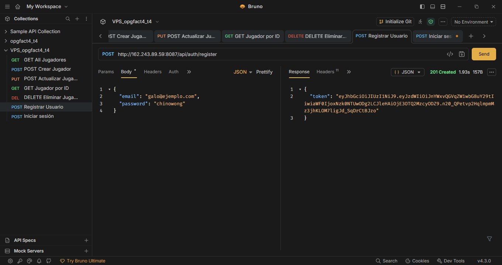
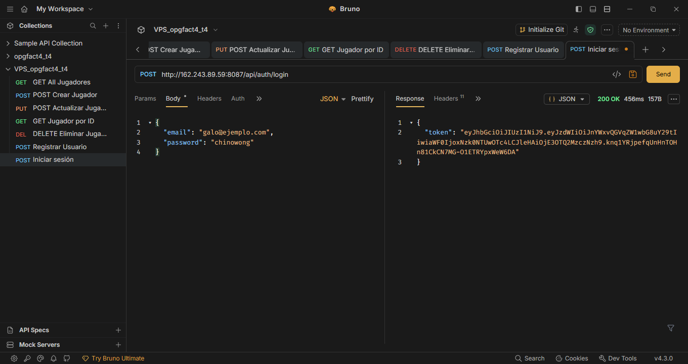
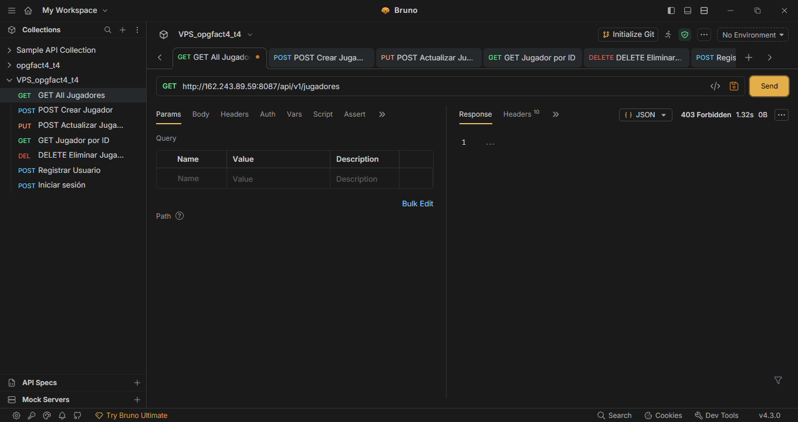
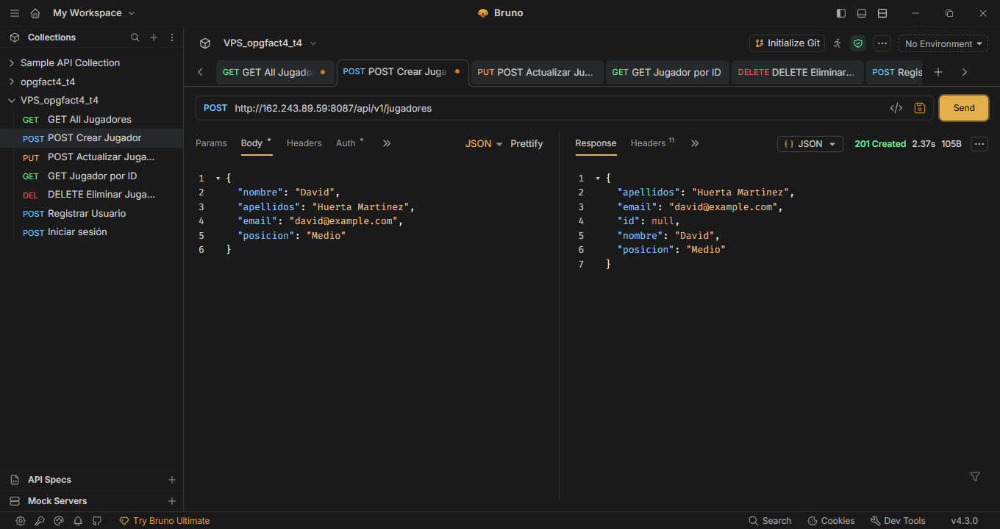
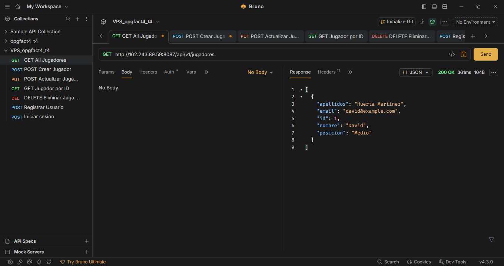
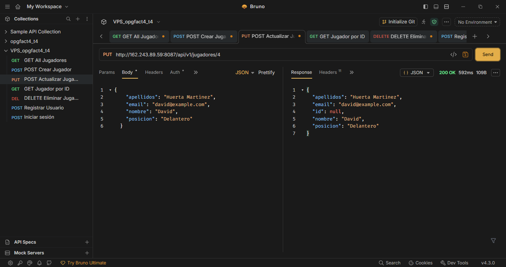

# Actividad 4: API REST con Spring Boot, Spring Security y JWT

**Autor:** Gael Fernando Ortiz Pérez  
**Materia/Institución:** Instituto Tecnológico de Oaxaca (TecNM / ITO) - Ingeniería en Sistemas Computacionales
**Grupo:** 7SD
**Puerto de Despliegue VPS:** 8089

## Descripción del Proyecto

Este proyecto es una API REST pura desarrollada en Spring Boot. A diferencia de actividades anteriores, no utiliza vistas renderizadas por el servidor (Thymeleaf), sino que devuelve respuestas estructuradas en formato JSON. Implementa seguridad real mediante **Spring Security** y **JWT (JSON Web Tokens)**, protegiendo las rutas del CRUD para que solo puedan ser consumidas por usuarios autenticados.

## Características Principales

- **Autenticación y Seguridad:** Rutas públicas para registro y login. Generación y validación de tokens JWT mediante `OncePerRequestFilter`.
- **Uso de DTOs:** Transferencia de datos controlada usando objetos DTO (`JugadorDTO`, `LoginDTO`, `RegistroDTO`) para evitar exponer entidades directamente a la base de datos.
- **Validación de Datos:** Uso de anotaciones de Bean Validation (`@Valid`, `@NotBlank`, `@Email`). Los errores devuelven un código HTTP 400 (Bad Request) estructurado.
- **Verbos HTTP Correctos:** Implementación de `@GetMapping`, `@PostMapping`, `@PutMapping` y `@DeleteMapping` con respuestas `ResponseEntity` (200 OK, 201 Created, 404 Not Found, 403 Forbidden).
- **Colección de Bruno:** Pruebas de la API documentadas y versionadas dentro del mismo repositorio.

## Estructura de Paquetes

- `entity`: Entidades mapeadas a la base de datos MySQL (`Jugador`, `Usuario`).
- `dto`: Objetos de transferencia de datos con reglas de validación.
- `repository`: Interfaces JpaRepository para interacción con MySQL.
- `service`: Lógica de negocio, guardado de jugadores y cifrado de contraseñas (BCrypt).
- `controller`: Endpoints expuestos (`AuthController` para accesos públicos, `JugadorController` para el CRUD protegido).
- `security`: Configuración del filtro, generación de JWT y Beans de autenticación.
- `exception`: Manejador global (`@RestControllerAdvice`) para interceptar errores de validación.

## Despliegue en VPS

La API se encuentra desplegada y funcionando en el servidor VPS del equipo. Se ejecuta en segundo plano como un `.jar` independiente, configurado en un puerto específico para no afectar las actividades 1, 2 y 3.

- **URL Base VPS:** `http://162.243.89.59:8087/api`

## Colección de Bruno

Las peticiones necesarias para probar la API están incluidas en la carpeta `/Coleccion BRUNO` en la raíz de este repositorio.

1. Instala [Bruno](https://www.usebruno.com/).
2. Abre la carpeta `/Coleccion BRUNO` desde la aplicación.
3. Ejecuta primero `POST Registro` y `POST Login` para obtener tu token.
4. Pega el token en la pestaña "Auth -> Bearer" de las peticiones CRUD.

---

## Capturas de Funcionamiento (Pruebas con Bruno)

### 1. Registro y Login (Autenticación)

**Registro de nuevo usuario (Devuelve 201 Created)**

**Login exitoso (Genera y devuelve token JWT)**

### 2. Operaciones CRUD (Rutas protegidas)

**Petición SIN Token (Rechazada con código 403 Forbidden)**

**Crear Jugador (POST con Token Bearer)**

**Listar Jugadores (GET)**

**Actualizar Jugador (PUT)**

**Eliminar Jugador (DELETE)**

